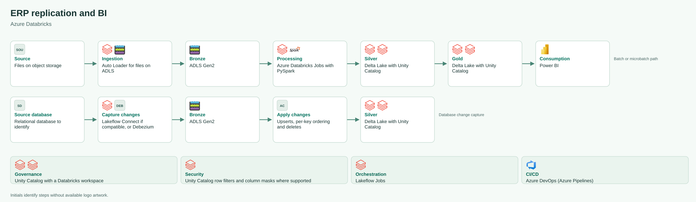
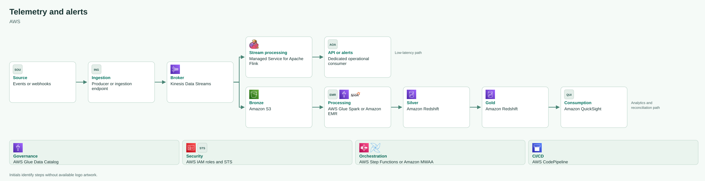

# Data Architecture Builder

**MVP · Guided data architecture design**

Data Architecture Builder turns project requirements into a **data architecture proposal with a rationale for each decision**. Answer questions about data sources, volumes, freshness, and how people or applications will use the data. The app recommends a technology stack, a data model, and a storage plan, then generates a data flow diagram and Word documents.

[Features](#features) · [Examples](#examples) · [Try the app](#try-the-app) · [Code guide](#code-guide) · [Deploy to GitHub Pages](#deploy-to-github-pages)

## Features

| Area | What the MVP provides |
| --- | --- |
| **Architecture** | Recommends a data warehouse, lakehouse, hybrid architecture, or operational serving design. Explains the choice of batch, microbatch, streaming, or Lambda processing. |
| **Data layers and modeling** | Recommends Medallion or a simpler layout based on the use case. Evaluates star schemas, snowflake schemas, and denormalized tables for analytics. |
| **Technology choices** | Compares stacks and services against project constraints. Applies compatible preferences for each stage, such as Airflow for orchestration, Terraform for infrastructure, and GitHub Actions for CI/CD. |
| **Capacity and storage** | Estimates raw storage using data volume, retention, the physical storage factor, and copy count. Shows a subtotal for known values and identifies layers that need more measurements. |
| **Exports** | Generates SVG diagrams and two Word documents covering the architecture proposal and implementation guide. The interface supports English and Italian. |

The MVP uses **explicit decision rules**. Each proposal helps you explain the design and identify what to measure on a representative workload, such as latency, throughput, and query concurrency.

## Examples

### ERP replication and reporting on Azure Databricks

The proposal uses microbatch processing, change data capture (CDC), and a **Bronze / Silver / Gold** layout. It uses ADLS Gen2 for raw data, Delta Lake tables governed by Unity Catalog, and Power BI for reporting.

### Telemetry and alerts on AWS

The proposal uses a **Lambda architecture**. One path uses Kinesis and Flink for low-latency alerts. The other archives events in S3 and publishes analytics tables to Redshift for reporting.

## Try the app

Open [`index.html`](index.html) from a local copy of the project. The app runs in the browser using HTML, CSS, and JavaScript. It requires no backend, build step, or API key.

1. Set **Language** to **English**. Load **ERP replication · Azure Databricks** or **Telemetry · AWS** from the example menu, or start with the questionnaire.
2. Open **Technology preferences by stage** to choose services you already use or want to evaluate. Leave a field on **Automatic** to let the app choose from the project requirements and stack.
3. Enter available measurements in the **Sizing calculator**. Generate the architecture, review the rationale, and download a diagram or Word document.

## Code guide

| Entry point | Responsibility |
| --- | --- |
| [`index.html`](index.html) and [`showResult()`](app.js#L121) | App interface, results screen, and export controls |
| [`questions.js`](questions.js#L2) | Questionnaire groups, options, and decision criteria |
| [`design()`](design.js#L63) | Builds the proposal, data flows, validation checks, and rationale |
| [`recommendPlatform()`](platforms.js#L82) and [`resolvePipelinePreferences()`](technology-preferences.js#L38) | Chooses the stack and applies technology preferences by stage |
| [`architectureRecommendation()`](recommendations.js#L23) and [`modelRecommendation()`](recommendations.js#L1) | Recommends the architecture, processing pattern, and data model |
| [`medallionPlan()`](medallion.js#L24) | Selects the data layers and describes how to implement them |
| [`envelope()`](additions.js#L70) and [`planStorage()`](storage-plan.js#L5) | Estimates capacity and builds a storage plan by service |
| [`visualDiagram()`](visual-flow.js#L19), [`exportWord()`](exports.js#L90), and [`implementationGuide()`](learning.js#L183) | Generates the diagram, technical proposal, and implementation guide |

## Deploy to GitHub Pages

1. Upload the project files to the root of the public repository. Keep `index.html` at the root and include `slides/` and `assets/`.
2. Open **Settings → Pages**, select **Deploy from a branch**, then choose **`main` → `/ (root)`**.
3. Open the URL shown in **Settings → Pages** once deployment finishes.

**Author** · Antonio Fiumanò
